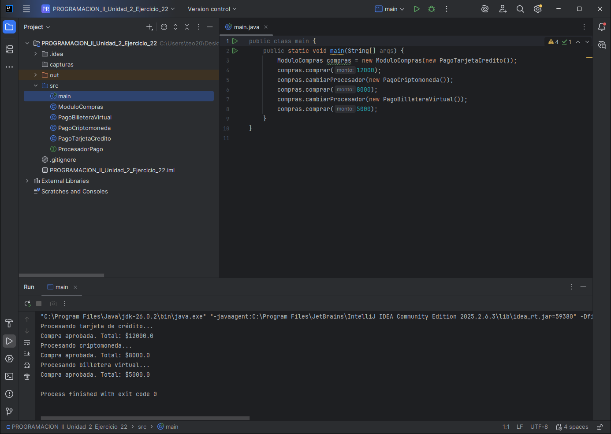

# PROGRAMACIÓN II — Unidad 2, Ejercicio 22: Pasarelas de Pago Multicanal

Trabajo práctico de Programación II. Este repositorio contiene la resolución en Java del ejercicio 22 de la Unidad 2.

## Consigna

#### Contexto

Una plataforma de comercio electrónico global necesita procesar transacciones monetarias a través de diferentes proveedores (tarjetas de crédito, criptomonedas y billeteras virtuales). Para mantener el sistema modular y desacoplado, la lógica de la tienda no debe cambiar según el medio de pago elegido; simplemente se comunica con una abstracción común.

#### Consigna

Modelar un sistema de pagos aplicando el principio de abstracción para que el módulo de compras pueda procesar transacciones utilizando distintas pasarelas de forma transparente.

#### Desarrollo requerido

- Definir una interfaz Pasipago o ProcesadorPago con el método abstracto boolean procesarPago(double monto).
- Crear clases concretas como PagoTarjetaCredito, PagoCriptomoneda y PagoBilleteraVirtual que implementen la interfaz anterior con su propia lógica de validación.
- Diseñar la clase ModuloCompras que mantenga una referencia a la interfaz abstracta del procesador de pagos, permitiendo cambiar de proveedor dinámicamente.
- En el método main, simular compras utilizando los diferentes procesadores de pago e imprimir el comprobante o rechazo por consola.

## Estructura del repositorio

```
PROGRAMACION_II_Unidad_2_Ejercicio_22/
├── README.md
├── capturas/
│   └── consola.png
└── src/
    ├── main.java   # clase con el método main
    ├── ModuloCompras.java
    ├── PagoBilleteraVirtual.java
    ├── PagoCriptomoneda.java
    ├── PagoTarjetaCredito.java
    └── ProcesadorPago.java
```

## Funcionamiento y lógica

El ejercicio usa una **interfaz** para que el módulo de compras pueda trabajar con cualquier medio de pago sin conocer cómo funciona cada uno.

### `ProcesadorPago` (interfaz)

Define el contrato `boolean procesarPago(double monto)`, que todos los medios de pago tienen que cumplir.

### `PagoTarjetaCredito`, `PagoCriptomoneda` y `PagoBilleteraVirtual`

Implementan la interfaz (`implements`), cada uno con su propia regla:

- **Tarjeta de crédito:** aprueba montos positivos de hasta $100000.
- **Criptomoneda:** aprueba montos positivos de hasta $50000.
- **Billetera virtual:** aprueba cualquier monto positivo.

### `ModuloCompras`

Guarda un `ProcesadorPago` (que recibe en el constructor) y no sabe de qué tipo concreto es.

- **`comprar(double monto)`:** le pide al procesador que cobre y, según la respuesta, informa si la compra se aprobó.
- **`cambiarProcesador()`:** reemplaza el medio de pago en tiempo de ejecución.

### `main`

Crea el módulo con tarjeta de crédito y compra por $12000. Después lo cambia a criptomoneda y compra por $8000, y por último a billetera virtual y compra por $5000. Las tres compras se aprueban, y cada medio muestra su propio mensaje de procesamiento.

## Ejecución

Captura de la consola de IntelliJ IDEA ejecutando el programa:



Salida obtenida:

```
Procesando tarjeta de crédito...
Compra aprobada. Total: $12000.0
Procesando criptomoneda...
Compra aprobada. Total: $8000.0
Procesando billetera virtual...
Compra aprobada. Total: $5000.0
```
